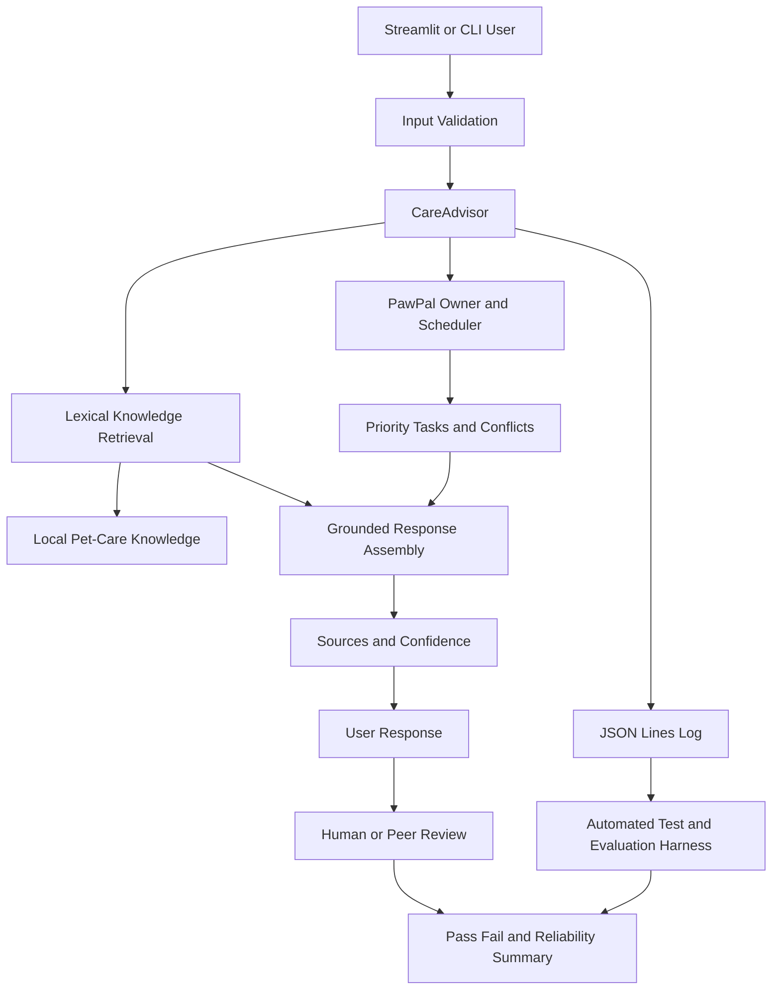

# PawPal+ Applied AI System

## Base Project

**Base project:** [ai110-module2show-pawpal-starter](https://github.com/Gbemiga04/ai110-module2show-pawpal-starter)

PawPal+ started as a Module 2 Python/Streamlit system for helping pet owners organize routine
care tasks. Its original goals were to track pets and tasks, build priority-first schedules,
detect conflicts, find open time slots, support recurring care, and preserve data in JSON.

This applied AI extension retains that scheduling foundation and adds a retrieval-augmented
care-plan advisor that grounds recommendations in a local knowledge source. It also contributes
source citations, confidence scores, refusal behavior, logging, and automated reliability tests.

## What the System Does

The RAG Care-Plan Advisor:

1. Validates a user's question.
2. Retrieves relevant sections from `data/pet_care_knowledge.md`.
3. Combines retrieved guidance with the owner's current tasks and schedule conflicts.
4. Produces a grounded answer with source filenames, section names, and a confidence score.
5. Refuses answers when the local knowledge base has no relevant support.
6. Records questions, answers, sources, confidence, and retrieved sections in JSON Lines.

The advisor is intentionally local and deterministic. It does not send pet or owner data to an
external AI service.

## Architecture

See [diagrams/architecture.mmd](diagrams/architecture.mmd).

The diagram separates input validation, local retrieval, PawPal scheduling, grounded response
assembly, and audit logging. Knowledge retrieval and scheduling context are combined before the
system produces a cited answer. Automated pytest cases and human/peer review validate behavior,
while the JSON Lines log preserves inputs, sources, confidence, and failures for later inspection.



## Setup

Requirements:

- Python 3.10 or newer
- Internet access is only needed to install packages

From PowerShell:

```powershell
python -m venv .venv
.venv\Scripts\Activate.ps1
python -m pip install -r requirements.txt
```

## Run the Streamlit App

```powershell
streamlit run app.py
```

Open the local URL printed by Streamlit. Use the pet/task controls, then ask a question in
**RAG Care-Plan Advisor**.

## Run the CLI Demonstration

```powershell
python main_advisor.py
```

## Run Tests

```powershell
python -m pytest
```

## Run the Evaluation Harness

```powershell
python evaluate_advisor.py
```

The harness runs predefined retrieval and refusal cases and prints pass/fail scores.

The tests cover the original scheduling behavior and the RAG additions:

- Knowledge retrieval
- Unsupported-question refusal
- Empty and oversized input
- Source and confidence reporting
- JSON Lines logging
- Recurring tasks
- Conflict detection
- Persistence and task filtering

## Example 1: Medication

```text
Input:
How should I schedule medication?

Output:
Medication times should match the prescription exactly. If a dose is missed,
follow the medication label or veterinarian's advice rather than guessing or
automatically doubling the dose.

Sources: pet_care_knowledge.md#Schedule conflicts,
pet_care_knowledge.md#Medication,
pet_care_knowledge.md#Daily routines
Confidence: 90%
```

## Example 2: Overlapping Schedule

```text
Input:
How should I handle overlapping medication and walk tasks?

Output:
Overlapping tasks should be separated when possible, especially if they involve
exercise, medication, or a veterinary routine.

Current priority context: Mochi: Medication at 08:00 AM (high priority).
Scheduling caveat: Conflict warnings identify tasks that overlap.

Sources: pet_care_knowledge.md#Schedule conflicts,
pet_care_knowledge.md#Medication
Confidence: 75%
```

## Example 3: Unsupported Question

```text
Input:
What is quantum cryptography?

Output:
I do not have enough supporting guidance in the local knowledge base to answer
that safely. Please rephrase the question or consult a veterinarian.

Sources: none
Confidence: 20%
```

## Guardrails

- Questions must be non-empty and no longer than 500 characters.
- Answers must be tied to retrieved knowledge; unsupported questions are refused.
- The source section is displayed with every answer.
- Responses include a general-medical-guidance disclaimer.
- The system never changes medication doses or makes medical diagnoses.
- Failures are handled explicitly rather than silently returning a success-shaped result.
- Retrieved text, sources, confidence, and user questions are logged to
  `assets/advisor_log.jsonl`.

## Reliability Results

The project includes automated tests for both the original PawPal logic and the new RAG
components. The last local run collected 28 tests and passed all 28.

AI collaboration and one accepted/revised implementation decision are documented in
[model_card.md](model_card.md), in **AI Collaboration → Collaboration Examples**.

## Reproducible Command Evidence

Run the complete automated suite:

```powershell
python -m pytest
```

```text
============================= test session starts =============================
collected 28 items
test_pawpal_system.py ...................                                [ 67%]
tests\test_care_advisor.py ....                                          [ 82%]
tests\test_pawpal.py .....                                               [100%]
============================= 28 passed in 0.05s ==============================
```

Run the predefined RAG and guardrail cases:

```powershell
python evaluate_advisor.py
```

```text
PawPal+ RAG Evaluation
PASS: medication retrieval
  confidence=90%
PASS: unsupported refusal
  confidence=20%
  sources=none
PASS: exercise retrieval
  confidence=75%
Summary: 3/3 passed
```

## Testing Summary

**What worked:** Retrieval returned the appropriate medication, exercise, and conflict sections;
unsupported questions were refused; empty input was rejected; and source/confidence reporting
was consistent. All 28 automated tests passed.

**What did not work initially:** A general-routines chunk could be retrieved for an unrelated
question, and one base test used a stale fixed date. These failures led to stop-word filtering,
unsupported-topic refusal checks, and a date-relative recurrence test.

**What I learned:** Lexical RAG can be reproducible and useful but is sensitive to wording.
Explicit guardrails and negative tests are necessary because a plausible answer can still be
unsupported or medically unsafe.

## Design Decisions

- **Local knowledge instead of a hosted API:** PawPal+ remains runnable and reproducible without
  API credentials, and pet data does not leave the user's computer.
- **Lexical retrieval instead of vector embeddings:** Lexical matching is easier to inspect and
  test in a four-hour project, though it misses semantically equivalent wording.
- **Template assembly instead of free-form generation:** This limits unsupported elaboration and
  ensures source, confidence, and disclaimer fields accompany the answer.
- **Refusal over guessing:** Unsupported topics receive a safe fallback instead of adding plausible
  but ungrounded pet-care claims.

## Reflection

This project taught me that an AI feature is only useful when its retrieval, application logic,
guardrails, and tests operate together. Building PawPal+ showed me how to transform an existing
prototype into a traceable, maintainable system while recognizing that confidence is a measurement
of support, not proof of medical accuracy.

## Portfolio

**GitHub:** https://github.com/Gbemiga04/applied-ai-system-project

This project says that I can extend a prior software project, integrate AI retrieval responsibly,
add automated and guardrail testing, document trade-offs, and communicate reproducible evidence
to future employers and teammates.

## Limitations

- Retrieval is lexical, not semantic vector search.
- Knowledge coverage is intentionally limited to a few general care topics.
- Scheduling context is local and does not validate real veterinary instructions.
- The advisor is not a substitute for a veterinarian.
- Time and species-specific exercise or feeding guidance may require professional input.
