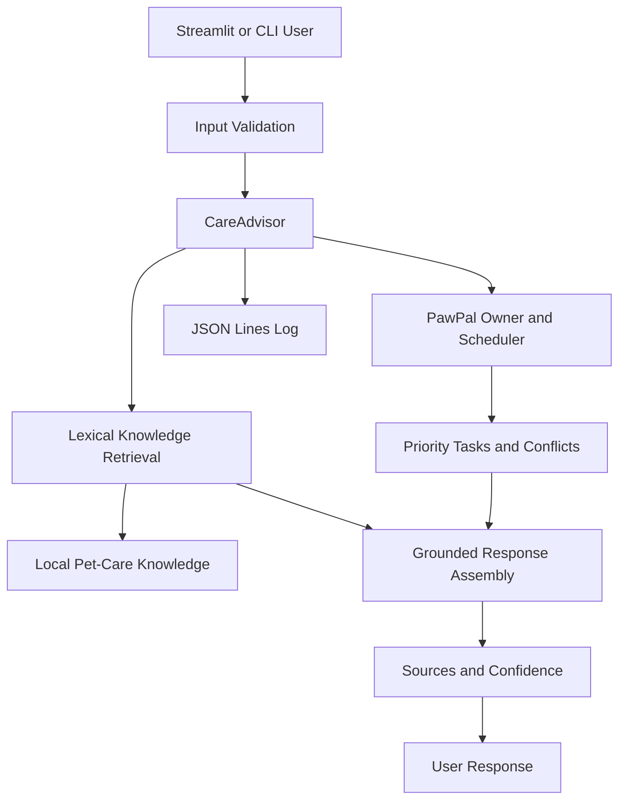

# PawPal+ Applied AI System

## Base Project

**Base project:** [ai110-module2show-pawpal-starter](https://github.com/Gbemiga04/ai110-module2show-pawpal-starter)

PawPal+ started as a Module 2 Python/Streamlit pet-care scheduling system. This applied AI
extension retains pet/task management, priority scheduling, recurrence, conflict detection,
open-slot finding, and JSON persistence, then adds a retrieval-augmented care-plan advisor.

## What the System Does

The RAG Care-Plan Advisor:

1. Validates a user's question.
2. Retrieves relevant sections from `data/pet_care_knowledge.md`.
3. Combines retrieved guidance with the owner's current tasks and schedule conflicts.
4. Produces a grounded answer with source filenames, section names, and a confidence score.
5. Refuses answers when the local knowledge base has no relevant support.
6. Records questions, answers, sources, confidence, and retrieved sections in JSON Lines.

The advisor is intentionally local and deterministic. It does not send pet or owner data to an
external AI service.

## Architecture

See [diagrams/architecture.mmd](diagrams/architecture.mmd).



## Setup

Requirements:

- Python 3.10 or newer
- Internet access is only needed to install packages

From PowerShell:

```powershell
python -m venv .venv
.venv\Scripts\Activate.ps1
python -m pip install -r requirements.txt
```

## Run the Streamlit App

```powershell
streamlit run app.py
```

Open the local URL printed by Streamlit. Use the pet/task controls, then ask a question in
**RAG Care-Plan Advisor**.

## Run the CLI Demonstration

```powershell
python main_advisor.py
```

## Run Tests

```powershell
python -m pytest
```

The tests cover the original scheduling behavior and the RAG additions:

- Knowledge retrieval
- Unsupported-question refusal
- Empty and oversized input
- Source and confidence reporting
- JSON Lines logging
- Recurring tasks
- Conflict detection
- Persistence and task filtering

## Example 1: Medication

```text
Input:
How should I schedule medication?

Output:
Medication times should match the prescription exactly. If a dose is missed,
follow the medication label or veterinarian's advice rather than guessing or
automatically doubling the dose.

Sources: pet_care_knowledge.md#Schedule conflicts,
pet_care_knowledge.md#Medication,
pet_care_knowledge.md#Daily routines
Confidence: 90%
```

## Example 2: Overlapping Schedule

```text
Input:
How should I handle overlapping medication and walk tasks?

Output:
Overlapping tasks should be separated when possible, especially if they involve
exercise, medication, or a veterinary routine.

Current priority context: Mochi: Medication at 08:00 AM (high priority).
Scheduling caveat: Conflict warnings identify tasks that overlap.

Sources: pet_care_knowledge.md#Schedule conflicts,
pet_care_knowledge.md#Medication
Confidence: 75%
```

## Example 3: Unsupported Question

```text
Input:
What is quantum cryptography?

Output:
I do not have enough supporting guidance in the local knowledge base to answer
that safely. Please rephrase the question or consult a veterinarian.

Sources: none
Confidence: 20%
```

## Guardrails

- Questions must be non-empty and no longer than 500 characters.
- Answers must be tied to retrieved knowledge; unsupported questions are refused.
- The source section is displayed with every answer.
- Responses include a general-medical-guidance disclaimer.
- The system never changes medication doses or makes medical diagnoses.
- Failures are handled explicitly rather than silently returning a success-shaped result.
- Retrieved text, sources, confidence, and user questions are logged to
  `assets/advisor_log.jsonl`.

## Reliability Results

The project includes automated tests for both the original PawPal logic and the new RAG
components. The last local run collected 28 tests and passed all 28.

## Limitations

- Retrieval is lexical, not semantic vector search.
- Knowledge coverage is intentionally limited to a few general care topics.
- Scheduling context is local and does not validate real veterinary instructions.
- The advisor is not a substitute for a veterinarian.
- Time and species-specific exercise or feeding guidance may require professional input.
